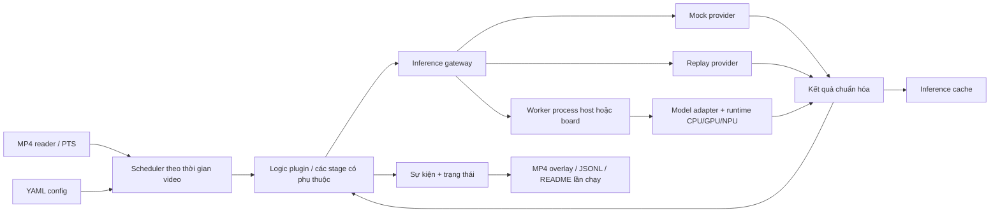

# Thiết kế simulator logic camera AI

Ngày: 2026-10-25. Trạng thái: đã được người dùng yêu cầu triển khai; baseline host đã hiện thực.
Cập nhật phạm vi: chỉ face recognition; CPU/GPU/NPU máy hiện tại. Board/dev kit để sau.
Kết quả nghiệm thu và các điều chỉnh triển khai: xem `docs/implementation-progress.md` và README.

## 1. Mục tiêu và quyết định đã thống nhất

Xây công cụ Python chạy trong Docker để thử nghiệm luồng xử lý giống dự án
camera AI thực tế. Input/output là MP4; thêm nhật ký kết quả AI và sự kiện nghiệp vụ.
Phạm vi triển khai trước chỉ gồm face recognition phục vụ điểm danh/blacklist.
Khói/lửa để giai đoạn sau, không nằm trong checklist triển khai hiện tại.

Đã thống nhất với người dùng:

- Tách inference khỏi logic nghiệp vụ; hỗ trợ mock, model thật và replay.
- Model và task mapping thay đổi được bằng config. Person detection và face
  detection mặc định 18 FPS, đổi được lịch bằng config. Embedding do logic lên
  lịch theo số mặt/trạng thái track, không có FPS riêng ở cấu hình model.
- FPS là lịch bơm frame theo thời gian video. Giả sử inference luôn hoàn thành
  trước lần bơm tiếp theo; tốc độ máy không thay đổi kết quả thời gian giả lập.
- Thay được logic Python theo mức độ nghiên cứu; mỗi phiên bản logic có tên
  `taskname-date-time` và README cụ thể.
- Chọn môi trường host/board và CPU/GPU/NPU; board có cấu hình kết nối riêng.
- Embedding chọn tối đa 1 mặt hợp lệ mỗi lượt detection, luân phiên giữa các
  track chưa xác nhận; không có mặt hợp lệ thì không gọi model.

Các mặc định nghiên cứu dưới đây được triển khai theo thiết kế và có thể thay bằng policy/config.
Không dùng simulator để kết luận throughput hay độ trễ triển khai thực tế.
Không xây UI, dịch vụ camera live hoặc RTSP trong phạm vi MP4 ban đầu.

## 2. Các hướng đã xem xét

1. Mock hoàn toàn: dễ tạo tình huống nhưng không phản ánh nội dung video.
2. Chỉ model thật: sát luồng inference nhưng khó tái hiện các ca nghiệp vụ hiếm.
3. Mock + model thật + replay: thêm quản lý artifact, đổi lại cùng một logic có
   thể kiểm thử có kiểm soát và chạy trên dữ liệu thực. Người dùng đã chọn hướng này.

## 3. Kiến trúc



Simulator giữ state nghiệp vụ trên host. Inference worker là process riêng:
local worker trong Docker khi chạy host; worker trong container trên board khi
chạy remote. Model được load một lần trong worker và tái sử dụng.
Giao diện request/response giống nhau; mock/replay có thể chạy ngay tại gateway.
Không cần message broker hoặc Kubernetes cho một video trong bản đầu.

Giao diện plugin thực tế: `create(config, gateway, run_path)` trả object có
`tick(frame)`, `render(frame)`, `finalize()`. Các bước detection/tracking/chọn mặt/
nhận diện nằm trong tick, kiểm thử độc lập bằng các module business logic.
Plugin quyết định phụ thuộc/crop/tracking/nghiệp vụ; gateway và scheduler dùng chung.
Đổi thuật toán cần đổi plugin Python; đổi tham số hoặc model đã có adapter chỉ đổi YAML.

## 4. Quy ước thời gian

- Đọc PTS/time_base của video, chuẩn hóa frame đầu thành thời điểm 0. Dùng phân số
  hoặc integer time units, không cộng dồn số thực làm trôi lịch.
- Chỉ stage detection chọn đúng một trong `fps` hoặc `interval_ms`, thêm
  `offset_ms` mặc định 0. Person/face mặc định cùng 18 FPS. Giá trị phải dương;
  `enabled: false` để tắt. Embedding không khai báo fps/interval/offset, chỉ được
  logic phát request theo số mặt; validation từ chối lịch thời gian ở stage này.
- Lịch là `offset + k * interval`. Một slot dùng frame đầu tiên có PTS >= slot.
  Ghi cả `scheduled_at` và `source_pts`; kết quả có hiệu lực tại `source_pts` để
  không sử dụng thông tin từ tương lai của video. Lịch slot này chỉ áp dụng cho
  detection; embedding nhận dispatched_at của lượt được logic chọn và giữ
  source_pts của crop làm bằng chứng.
- Nếu video thiếu frame hoặc FPS model cao hơn FPS nguồn: nhiều slot trỏ cùng
  frame được gộp thành một lần gọi stage; không lặp inference cùng frame/crop.
  Không bù dồn những slot đã bỏ qua. Báo số slot gộp trong metrics.
- Ví dụ nguồn 30 FPS, person/face 18 FPS: các frame 0, 2, 4, 5, 7, 9...
  Nguồn 29.97 FPS dùng PTS, không làm tròn thành quy tắc bỏ cố định N frame.
- Khi gọi model thật, simulator chờ kết quả; không cộng wall-clock inference,
  network hoặc queue vào video clock, không sleep theo FPS.
- Timeout kết nối/inference dùng wall clock để phát hiện lỗi hạ tầng. Mặc định lỗi
  sẽ dừng run và đánh dấu failed, không giả lập thành kết quả không có đối tượng.
- `start_ms`, `end_ms` chọn đoạn video theo timeline gốc; lưu cả PTS gốc và thời gian
  tương đối của run. Thời gian nghiệp vụ dùng thời gian tương đối của run.
- Nếu cần ngày điểm danh: `business_start_at` có timezone ứng với PTS 0 đã chuẩn
  hóa của video gốc. Ngày nghiệp vụ = mốc này + PTS gốc đã chuẩn hóa, kể cả khi
  cắt đoạn giữa video; TTL/cooldown vẫn dùng run-relative time. Không lấy ngày
  hệ điều hành ở từng lần xử lý frame.
- Tick timer và timeout nghiệp vụ chạy theo từng PTS kể cả frame không inference.

## 5. Chuỗi model và dữ liệu

Luồng điểm danh/blacklist đề xuất:

`MP4 -> person detection -> tracking -> person crop -> face detection -> quality
gate -> align face -> embedding -> gallery match -> identity confirmation -> events`.

- Person và face chạy theo lịch detection 18 FPS mặc định, cùng offset. Trên cùng
  frame, person -> tracking -> face -> quality -> logic chọn mặt -> embedding.
  Face gắn với track; embedding dùng nguyên crop/landmarks cùng observation.
- Face detection dùng person observation mới trên cùng frame. Validation từ chối
  lịch face không nằm trong lịch person, trừ khi chọn explicit `skip_missing`.
  Không tự tăng số lần gọi person để bù cho lịch face.
- **Embedding không có đồng hồ FPS.** Sau mỗi lượt face detection, logic cập nhật
  danh sách mặt đủ chất lượng và chọn tối đa N mặt để nhận diện. N và quy tắc chọn
  thuộc policy của phiên bản logic, không thuộc manifest/adapter/runtime model.
- Đã chốt với người dùng: N = 1 mỗi lượt detection, round-robin
  giữa các track chưa xác nhận; mọi track hợp lệ đều có lượt, không ưu tiên vô hạn
  người mới khiến người cũ bị bỏ đói. Mặt chưa đủ chất lượng không chiếm lượt.
- Mỗi track có tối đa một crop đang chờ. Crop mới thay crop cũ nhưng giữ vị trí
  luân phiên của track; khi đến lượt lấy crop mới nhất còn hợp lệ. Mặc định chỉ
  dispatch track được quan sát ở lượt hiện tại; track mất mặt giữ vị trí tạm thời
  nhưng không cản các track khác, track lost bị xóa. Không tạo backlog vô hạn.
- Track đã confirmed ra khỏi danh sách cần embedding của baseline; track unknown/
  ambiguous tiếp tục được luân phiên với observation mới. Đổi quy tắc ưu tiên,
  retry hoặc reverify thuộc logic plugin và README phiên bản đó.
- Hết danh sách hoặc không có mặt hợp lệ thì không gọi embedding. Nếu N = 1 mà
  chỉ có một mặt chưa xác nhận, mặt đó có thể được gọi mỗi lượt detection; đây là
  hệ quả của logic, không phải embedding được cấu hình 18 FPS.
- `source_pts` là thời điểm crop, `dispatched_at` là thời điểm logic chọn mặt;
  embedding có hiệu lực tại dispatched_at. `scheduled_at` của embedding là null;
  trace ghi turn ID, số mặt hợp lệ, thứ tự hàng đợi, N, selected/deferred và lý do.
- Đã xử lý cùng crop/model fingerprint thì tái dùng kết quả, không tính phiếu mới.
  N giới hạn số mặt được logic chọn, không phải tensor batch size: adapter có thể
  chia batch/chạy tuần tự mà không đổi quyết định chọn mặt hoặc video clock.
- Tracker IoU đơn giản ở MVP, đánh dấu rõ đây là tracker nghiên cứu. Giữ track
  trong `track_ttl_ms`; hết hạn thì kết thúc track. Overlay box cũ phải có tuổi dữ
  liệu, không coi việc vẽ lại box là observation hoặc phiếu xác nhận mới.
- TTL/cooldown/ROI/threshold/confirmation window đều dùng thời gian video.
- `InferenceRequest`: schema version, request ID, stage, frame ID, source PTS,
  scheduled time, model fingerprint, input pixel hash, crop ID/parent ID,
  dispatched_at, image dimensions và transform từ crop về frame gốc.
- `InferenceResult`: request ID, stage, schema version, source/model provenance,
  detections/landmarks/embedding/quality tùy task, runtime thực dùng, trạng thái.
  Empty-success khác error, khác skipped và khác replay-missing.
- Bbox chuẩn hóa là `xyxy` theo pixel frame gốc; lưu kích thước ảnh, score, class.
  Embedding có dimension, normalization, embedding-space ID; không trộn hai model.
- Mỗi model adapter sở hữu resize/letterbox, BGR/RGB, normalization, layout,
  output decoding, class mapping và alignment; không để các chi tiết này vào business logic.

## 6. Mock, real và replay

Chọn provider độc lập cho từng stage; có thể real person + mock face/embedding.
Mock dùng kịch bản theo timestamp/observation ID và seed, xuất cùng schema như real;
mock không bỏ qua nghiệp vụ để ghi thẳng sự kiện cuối cùng. Kịch bản phải mô tả
tọa độ/quan hệ crop hợp lệ với upstream khi trộn nguồn.

Cache ghi kết quả AI chuẩn hóa trước business logic, kèm request và provenance.
Key bao gồm input video hash, frame/PTS, stage, model artifact hash, adapter version,
  pre/postprocess config, pixel/crop hash và transform. Mock thêm scenario hash,
  seed và generator version vào fingerprint nguồn. Không phụ thuộc ngưỡng business
logic, để đổi nghiệp vụ mà dùng lại cache được.

Với embedding, frame ID trong cache key là frame nguồn của crop; frame dispatch
và dispatched_at không thuộc key vì không thay đổi input model. Key không chứa
request ID ngẫu nhiên hoặc run ID. Cache hit tạo response gắn với
request ID hiện tại, giữ original request/result ID trong provenance. Observation ID
ổn định theo nguồn/frame/crop/model, không tạo observation mới chỉ vì replay ở run khác.
`dispatched_at`/scheduled time của lần gọi hiện tại được gắn lại khi replay; kết quả
AI giữ source_pts và nội dung bằng chứng gốc. Logic chọn mặt luôn được chạy lại
khi replay; không phát lại trực tiếp quyết định hàng đợi từ run cũ. Đổi N/thứ tự
chọn mặt có thể gây cache miss nếu crop mới chưa được ghi. Mock phụ thuộc slot/turn
phải đưa slot/turn vào source fingerprint, không tái dùng sai lịch.

Hai cách replay:

- `strict` mặc định: chỉ replay request khớp; thiếu bất kỳ request cần thiết thì
  dừng với báo cáo thiếu và gợi ý inference lại. Không âm thầm lấy kết quả gần nhất.
- `fill_missing` tùy chọn: cache-miss gọi provider real đã cấu hình; kết quả mới
  ghi sang cache của run hiện tại, giữ nguyên cache nguồn, provenance từng record.

Đổi FPS không bị khóa vào lần ghi trước, nhưng replay chỉ thực hiện được khi có
đủ frame/crop cho lịch mới. Giảm FPS cũng có thể miss nếu lịch mới không trùng
frame đã ghi. Tăng FPS không tạo được observation mới từ cache thưa.
Đổi tracker/crop/alignment/model có thể làm cache downstream không còn khớp.
Đổi embedding model phải enroll lại gallery tương ứng.
Có thể thêm chế độ capture mọi frame sau MVP để tăng khả năng nghiên cứu nhiều lịch.

## 7. Phiên bản logic và lần thực thi

```text
logic_versions/
  face_recognition-2026-10-25-213000/
    README.md
    logic.py
    default.yaml
runs/
  face_recognition-2026-10-25-213000/
    20261025T213000+0700-<unique-id>/
      README.md
      config.resolved.yaml
      manifest.json
      output.mp4
      events.jsonl
      inference.jsonl
      trace.jsonl
      metrics.json
      evidence/
```

`logic_id` đúng dạng `taskname-YYYY-MM-DD-HHmmss`, gồm ngày và giờ/phút/giây
tạo phiên bản theo Asia/Saigon (UTC+07:00), ví dụ
`face_recognition-2026-10-25-213000`. Nếu tạo trùng task trong cùng giây thì
từ chối ghi đè và yêu cầu ID mới. Mỗi run có ID timestamp + unique ID và tạo
thư mục độc quyền để không ghi đè. Ngày đặt tên theo Asia/Saigon mặc định.

README phiên bản logic viết thủ công: mục đích, sơ đồ, trạng thái, model roles,
lịch stage, quy tắc/công thức, ví dụ timeline, sự kiện, config, lệnh Docker,
giới hạn, khác biệt so với phiên bản trước. Không chép toàn bộ framework để đổi logic.

README mỗi run sinh tự động: logic ID và source hash, input hash/đoạn video,
config đã resolve nhưng bỏ secrets, model hashes/adapter versions/gallery hash,
provider yêu cầu và thực dùng, lịch yêu cầu/thực gọi/skipped, nguồn replay, kết quả,
file output, lệnh chạy lại và trạng thái completed/failed/interrupted.
Snapshot mã plugin vào run để sửa file logic gốc sau này vẫn truy lại được;
manifest ghi dependency lock/container image digest khi lấy được.
Chỉ sửa tham số không cần nhân bản logic; thay thuật toán nên tạo phiên bản mới.

## 8. Logic nghiệp vụ ban đầu

### Điểm danh/blacklist

- Gallery gồm person ID, tên hiển thị, ảnh enrollment, membership blacklist và
  embedding theo model. Có lệnh enroll; gallery có fingerprint/version.
- Trạng thái track: detected -> face_ready -> candidate -> confirmed -> lost.
  Face nhỏ/mờ không được tính như nhận diện thất bại của một người đã biết.
- Matching cosine với threshold theo model, có best-vs-second margin. Mặc định
  nghiên cứu đề xuất cosine >= 0.45, margin >= 0.05; cần hiệu chỉnh theo dữ liệu.
- Xác nhận cần 3 observation embedding mới cùng identity trong cửa sổ 2 giây,
  không đếm kết quả giữ lại/replay cùng observation nhiều lần. Identity đổi hoặc
  observation quá hạn thì reset candidate; cho phép thay toàn bộ quy tắc ở plugin.
  N nhỏ và đông mặt có thể khiến một track không đủ 3 lượt trong 2 giây; trace
  phải giải thích được. Điều chỉnh N/cửa sổ xác nhận ở policy nghiệp vụ, không
  tăng embedding FPS hoặc bỏ qua yêu cầu đủ bằng chứng.
- Điểm danh một lần/person/ngày nghiệp vụ trong phạm vi một run, gộp nhiều track.
  Không duy trì dedup giữa các run nghiên cứu. Blacklist là kiểm tra độc lập, vẫn
  phát cảnh báo nếu người đó cũng đã điểm danh; cooldown đề xuất 30 giây/person.
- Unknown/ambiguous không tự gán identity và không phát điểm danh.
- Quality gate đầu tiên dùng kích thước face và độ nét từ ảnh. Detector confidence,
  quality score và similarity là ba đại lượng riêng. Quality gate không phải liveness.
- Events chứa video time, identity/track, evidence frame, observation IDs, rule
  và threshold đã quyết định; trace giải thích vì sao chưa phát event.

### Ngoài phạm vi triển khai trước

Khói/lửa là hướng mở rộng về sau; không tạo plugin/model/test khói/lửa trong bản
face recognition này. Các interfaces chung không khóa vào tên model cụ thể.

## 9. Model khởi đầu và runtime

Các lựa chọn sau để dựng baseline nghiên cứu, không khóa framework vào chúng:

| Role | Adapter/artifact đề xuất | Ghi chú |
|---|---|---|
| Person | MediaPipe person detector từ OpenCV Zoo, ONNX | Đánh giá video nhiều người trước khi giữ làm baseline |
| Face | YuNet từ OpenCV Zoo, ONNX | Pin artifact tương thích phiên bản OpenCV đã chọn |
| Embedding | SFace từ OpenCV Zoo, ONNX | Align 5 landmarks; gallery theo embedding space |
| Quality | Kích thước + độ nét | Chưa cần tải model quality riêng |

Nguồn đã tham khảo ngày 2026-10-25:

- [MediaPipe person detector](https://github.com/opencv/opencv_zoo/blob/main/models/person_detection_mediapipe/README.md)
- [YuNet](https://github.com/opencv/opencv_zoo/blob/main/models/face_detection_yunet/README.md)
- [SFace](https://github.com/opencv/opencv_zoo/blob/main/models/face_recognition_sface/README.md)
- [ONNX Runtime providers](https://onnxruntime.ai/docs/execution-providers/)
- [QNN provider](https://onnxruntime.ai/docs/execution-providers/QNN-ExecutionProvider.html)

Đề xuất baseline real dùng OpenCV DNN CPU cho các adapter Zoo; thêm ONNX Runtime
adapters cho GPU/NPU khi kiểm chứng preprocessing và operators tương thích.
Manifest model phải có URL artifact pin revision, SHA-256, license model/code,
task/output schema, input spec, adapter version và runtime compatibility đã test.
Đã tải model và kiểm checksum chính thức; registry hiện dùng YOLOX person thay
MediaPipe pose baseline để lấy bbox toàn thân. YuNet/SFace giữ nguyên. Xem configs/models.yaml.
Đổi weights cùng adapter và schema chỉ sửa config; kiến trúc/output khác cần adapter mới.

`target` (host/board), `device` (cpu/gpu/npu), `runtime` (opencv/onnxruntime/openvino)
là các lựa chọn độc lập có kiểm tra compatibility. Container không tự cung cấp
driver. GPU/NPU cần đúng driver, runtime libraries, device access, operators và
đôi khi quantization/chuyển artifact; không có image phổ quát cho mọi board/NPU.
Mặc định `allow_fallback: false`; thiếu backend thì lỗi rõ. Nếu cho phép fallback,
ghi provider thực dùng và mức phân chia graph khi runtime cung cấp thông tin;
không báo thành công NPU chỉ vì tên provider đã được chọn.

## 10. Docker và board

Stack đề xuất: Python 3.11, PyAV/FFmpeg cho PTS và MP4, NumPy/OpenCV cho crop/
adapter, Pydantic + YAML cho config, pytest cho hành vi, Paramiko cho SSH nếu cần
password prompt. Pin dependency/image digest ở giai đoạn triển khai.

Compose có simulator và local inference-worker; profile CPU mặc định, NVIDIA GPU
riêng; board image/runtime theo kiến trúc và SDK đã xác minh. Mount input/model/
gallery read-only, runs writable. Data plane local dùng framed protocol qua stdin/stdout của worker process,
metadata JSON và ảnh PNG lossless; không mở TCP mặc định.
Remote dùng cùng framing trên SSH stdin/stdout, diagnostics qua stderr; chỉ cần
route SSH, không cần host và board chia sẻ filesystem. Model provision theo hash
trước khi chạy; không load lại model mỗi frame.

Board config chứa endpoint, SSH port, username và image/model root; password đọc
từ file secret mount hoặc nhập tại prompt. Password không ghi vào YAML snapshot,
README, command line hay log. SSH profile của môi trường dùng prompt theo chỉ dẫn
người dùng; không tự ghi lại thông tin bí mật có sẵn. QDC phải có session/Connect
tunnel hiện hành trước remote preflight; localhost trong container không phải
localhost host, nên route đến mapping của host phải cấu hình và kiểm chứng.

Hiện chưa xác minh board, runtime, Docker hay route thực tế. MP4 nằm ở host;
đầu vào remote là frame/crop PNG qua SSH, đầu ra là kết quả AI, output MP4 ghi tại
host. Không có MediaMTX owner, RTSP codec/port/listener ở thiết kế này.
Nếu thêm RTSP về sau, phải áp dụng đầy đủ hướng dẫn QDC/camera của người dùng,
ghi riêng hai data path và kiểm tra decoded frames end-to-end.

## 11. Ví dụ config (đặc tả dự kiến)

```yaml
schema_version: 1
logic_id: face_recognition-2026-10-25-213000
input:
  path: /data/input/demo.mp4
  start_ms: 0
  end_ms: null
  business_start_at: "2026-10-25T08:00:00+07:00"
output:
  root: /data/runs
  video: true
  codec: libx264
  audio: drop
execution:
  clock: video_pts
  latency: ideal
  seed: 42
targets:
  host_cpu:
    location: host
    device: cpu
    runtime: opencv
    allow_fallback: false
  board_npu:
    location: board
    device: npu
    runtime: qnn
    allow_fallback: false
    connection:
      host: ${BOARD_SSH_HOST}
      port: ${BOARD_SSH_PORT}
      username: ${BOARD_SSH_USER}
      password_file: /run/secrets/board_password
    worker_image: ${BOARD_WORKER_IMAGE}
    model_root: /opt/simulator/models
stages:
  person:
    provider: real
    model: mediapipe_person_baseline
    target: host_cpu
    fps: 18
  face:
    provider: real
    model: yunet_baseline
    target: host_cpu
    fps: 18
    dependency_policy: same_frame
  embedding:
    provider: real
    model: sface_baseline
    target: host_cpu
    trigger: logic
replay:
  policy: strict
  source: null
models:
  registry: /config/models.yaml
business:
  embedding_scheduler:  # Policy nghiệp vụ, không phải cấu hình model
    strategy: round_robin
    max_faces_per_turn: 1  # Mặc định đã thống nhất với người dùng
    stop_when_confirmed: true
  gallery: /data/gallery/baseline
  similarity_threshold: 0.45
  ambiguity_margin: 0.05
  confirm_observations: 3
  confirm_window_ms: 2000
  track_ttl_ms: 1000
  blacklist_cooldown_ms: 30000
```

Biến môi trường chỉ resolve cho target/stage được sử dụng; target board chưa dùng
không làm run CPU thất bại. YAML không chạy expression/Python tùy ý. Resolved config
không chứa giá trị secret hoặc nội dung file secret. Model registry chứa manifest
thực tế khi triển khai, không dùng model name để suy đoán input/output.

## 12. Tiêu chí nghiệm thu và thứ tự

1. MP4 -> mock -> điểm danh/blacklist -> MP4/events/README chạy được bằng Docker.
2. Đổi lịch/model/config không sửa core; model mới khác schema đi qua adapter.
3. Chèn delay vào worker không đổi timestamp/sự kiện; thay seed/config phải được ghi nhận.
4. Chạy real CPU và enroll gallery; kiểm chứng output MP4 có frame decode được và
   overlay thay đổi theo video, frame count và PTS đúng policy.
5. Replay cùng requests cho cùng events/state trace chuẩn hóa; các wall-time/run ID
   được loại khỏi so sánh. Cache thiếu/mismatch phải báo rõ.
6. Person/face mặc định 18 FPS. Embedding không có FPS, chỉ chạy theo số mặt
   được logic chọn; các ca 0/1/nhiều mặt, fairness, crop mới, mất track và confirmed
   đều có trace kiểm chứng. Không có model-call nào khi không chọn được mặt.
7. Host GPU/NPU: preflight, worker real, kết quả đúng schema và bằng chứng provider
   thực dùng. Docker CUDA GPU đã chạy thật; Intel NPU chưa được WSL expose nên
   preflight báo unavailable, không CPU fallback. Board/dev kit để giai đoạn sau.

Mỗi milestone phải tạo được artifact đọc được; các backend tăng tốc được nghiệm thu
theo từng tổ hợp hardware/runtime/model, không đánh đồng với hoàn thành core simulator.
